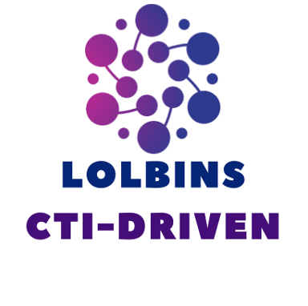
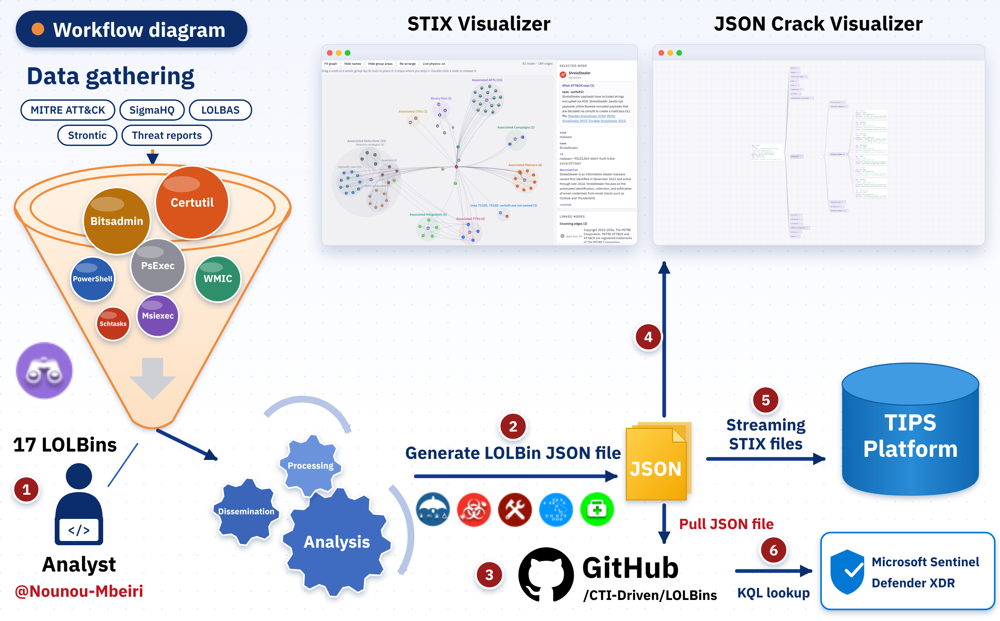
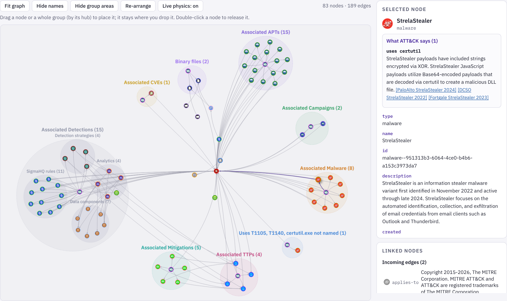
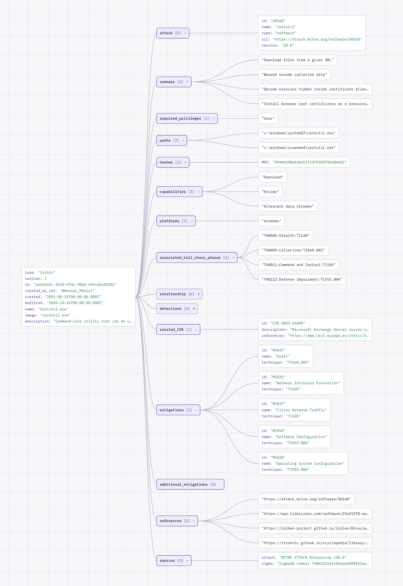
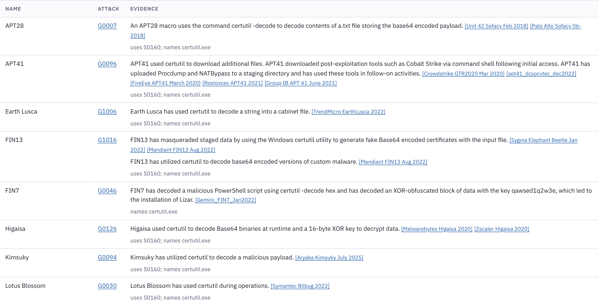
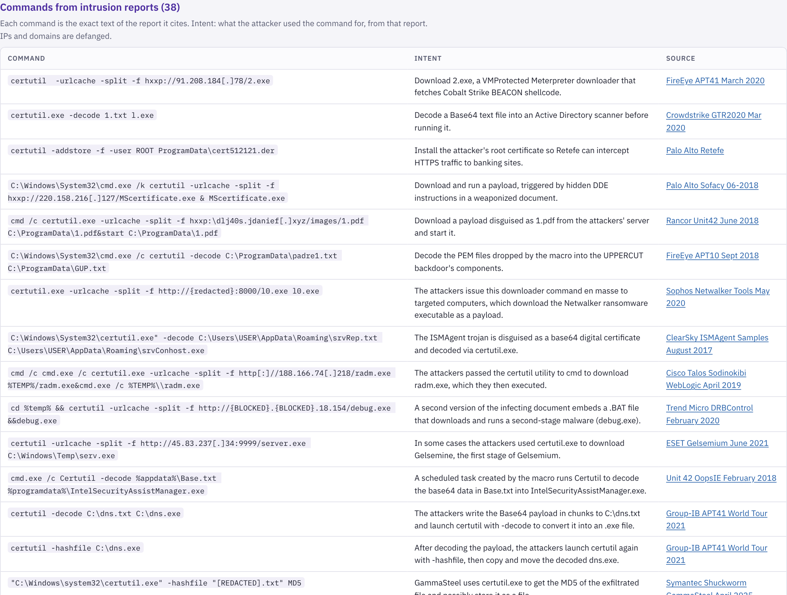
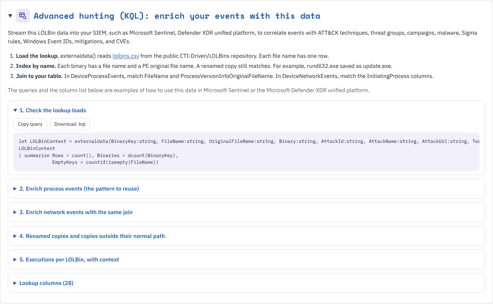
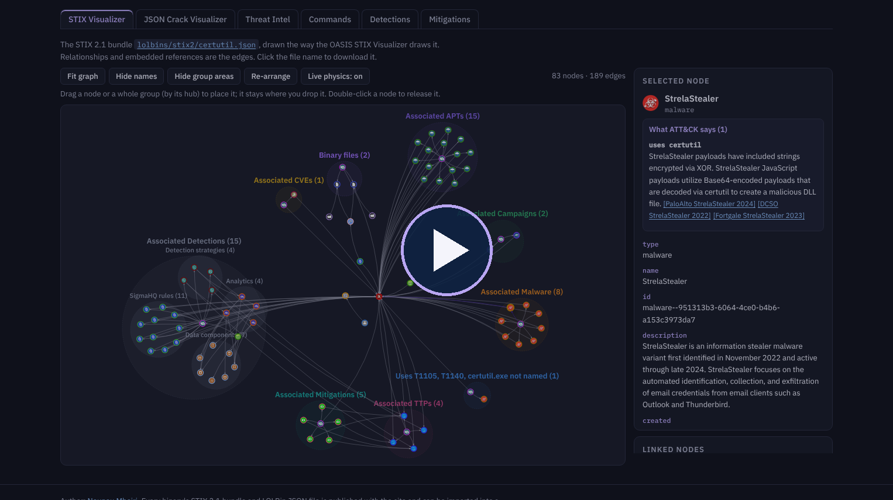

# LOLBins CTI-Driven

<p align="center">
  
</p>

<p align="center">
  <a href="https://lolbins-ctidriven.vercel.app">https://lolbins-ctidriven.vercel.app</a>
</p>

LOLBins CTI-Driven (Living-Off-the-Land Binaries, Cyber Threat Intelligence Driven) helps cyber defenders understand how living-off-the-land binaries are used by threat actors during an intrusion. Each binary is shown in a graphical, digestible format and published as STIX 2.1 for threat intelligence platforms (TIPs), with context from a cyber threat intelligence and cyber defence point of view.

**Covered binaries:** Certutil, Bitsadmin, Mshta, Rundll32, PsExec, Schtasks, Regsvr32, Reg, WMIC, Tasklist, At, CMD, PowerShell, Cscript, Wscript, Forfiles and Msiexec.

## What each binary includes

- Associated threat groups (APTs), campaigns, malware and tools, each with the ATT&CK statement that links it to the binary and the reports it cites
- Associated TTPs (ATT&CK techniques and tactics)
- Associated commands, each quoted from a threat report, with its intent and a link to the source
- Associated mitigations
- Associated CVEs
- Associated detections: SigmaHQ rules, Windows event IDs and MITRE ATT&CK detection strategies

## Screenshots

### Workflow



### STIX Visualizer

The binary's STIX 2.1 bundle. Selecting a node shows what ATT&CK says about its relationship to the binary, with the cited reports.



### JSON Crack Visualizer

The LOLBin template file as a tree. Large branches start folded.



### Threat Intel

Groups, campaigns, malware and tools, with ATT&CK's own statement for each and its sources.



### Commands

Only commands whose exact text is in the cited report. Each has an intent taken from that report.



### Advanced hunting (KQL)



### YouTube video demo

[](https://youtu.be/xiu17NC61J4 "LOLBins CTI-Driven on YouTube")

## Advanced hunting (KQL)

`lolbins/kql/lolbins.csv` is a lookup table with one row per file name of each binary. Each row carries the binary's ATT&CK techniques and tactics, the groups, campaigns and malware tied to it with evidence, its SigmaHQ rule count, Windows event IDs, mitigations and CVEs.

The queries in `lolbins/kql/` load the table with `externaldata()` from this repository's raw URL and join it to `DeviceProcessEvents`, or to any table with a process file name such as `DeviceNetworkEvents`. They match by file name or by PE original file name (`ProcessVersionInfoOriginalFileName`), so renamed copies match too. They run in Microsoft Defender XDR advanced hunting and in Microsoft Sentinel: the time column is read as `Timestamp` or `TimeGenerated`, whichever the table has.

| Query | What it does |
|---|---|
| `1-check-lookup.kql` | Checks that the lookup loads |
| `2-enrich-process-events.kql` | Enriches process events (the pattern to reuse) |
| `3-enrich-network-events.kql` | The same join on network events |
| `4-renamed-or-moved.kql` | Renamed copies and copies outside their normal path |
| `5-summary-by-binary.kql` | Executions per LOLBin, with context |

Every query is checked with Microsoft's KQL parser (Kusto.Language) against both table schemas, `Timestamp` and `TimeGenerated`, with no issues reported. The queries have not been run in a tenant. Start with `1-check-lookup.kql` to confirm `externaldata()` can reach the file.

## Use the data in a TIP

Import every binary at once from one STIX 2.1 bundle. Point your threat intelligence platform or script at this URL:

```
https://raw.githubusercontent.com/CTI-Driven/LOLBins/HEAD/lolbins/stix2/all.json
```

## Roadmap

- Add a TAXII 2.1 API so TIP platforms can poll the bundles. This needs a server, which the static site cannot provide.

## Author

[Nounou Mbeiri](https://www.linkedin.com/in/nounou-mbeiri) on LinkedIn, [@Nounou_Mbeiri](https://twitter.com/Nounou_Mbeiri) on Twitter.

## Support this project

If this project helps you, you can [buy me a coffee](https://buymeacoffee.com/ctidrivenprojects).

## Related Living-Off-the-Land Binaries projects

- https://lolol.farm
- https://lolbas-project.github.io

## Data sources and licenses

- [MITRE ATT&CK®](https://attack.mitre.org/), used under the [ATT&CK terms of use](https://attack.mitre.org/resources/legal-and-branding/terms-of-use/).
- [SigmaHQ](https://github.com/SigmaHQ/sigma) rules, released under the [Detection Rule License (DRL) 1.1](https://github.com/SigmaHQ/Detection-Rule-License). The STIX bundles embed the rules written for each binary, with their authors and a link to the original.
- [LOLBAS](https://lolbas-project.github.io/) and [Strontic xcyclopedia](https://strontic.github.io/xcyclopedia/) for paths, privileges, capabilities and file hashes.
- STIX icons from the [OASIS STIX Visualization](https://github.com/oasis-open/cti-stix-visualization) project (BSD 3-Clause).
- Commands are quoted from the threat reports linked next to each one. A command appears only when its exact text is in that report.

## Thanks

- [Scott Small](https://www.linkedin.com/in/scott-small-20ba0164/)
- [Carlos Diaz](https://www.linkedin.com/in/carlos-d-980a3541/)
- [Ivan Portillo](https://www.linkedin.com/in/ivanportillomorales/)
- Mark W
